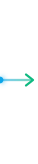
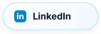
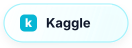

<!-- ✦ Crystal Lab Liquid Glass — GitHub Profile README (Kennedy Anderson) ✦ -->

  

<!-- ── Pipeline 3D Animado (cada etapa é clicável para a trilha no portfólio) ── -->

  

<!-- ── Componente Lissa · Guia de Trilhas & Stack ── -->

  

<!-- ── Métricas do GitHub (paleta Crystal Lab clara harmonizada) ── -->

  
  &nbsp;
  

<!-- ── Stack de Ferramentas ── -->

  

<!-- ── Dock Social Liquid Glass ── -->

  
  &nbsp;
  
  &nbsp;
  
  &nbsp;
  

<!-- ── Rodapé Liquid Glass Animado ── -->

  

